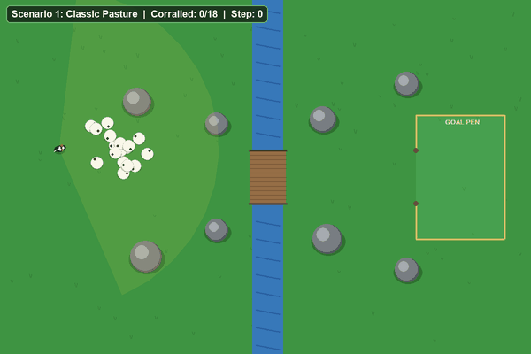
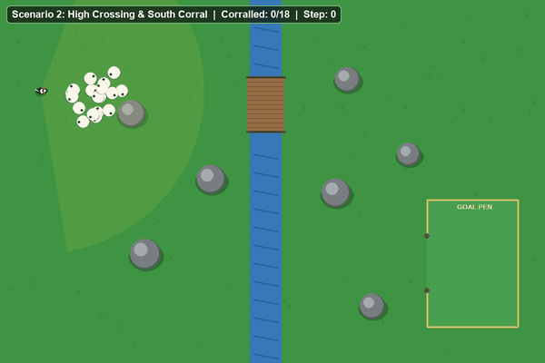
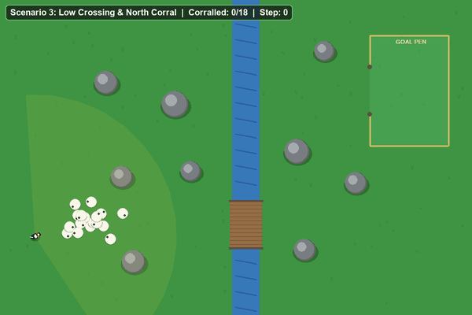

# Autonomous Transformer Shepherding Dog

Standalone code package for the manuscript *"Multi-Modal Transformer Control for Autonomous Shepherding Dog Across Diverse Obstacle Environments"*. It contains the essential files required to run the interactive 3-scenario simulation, single-run curriculum Evolution Strategies (ES) training, and the 30-seed statistical evaluation harness.

---

## Test Scenario Demonstrations

All animations below show the included pretrained champion (`best_dog_genome.pt`, Seed 1009) corralling `18/18` sheep across all three selectable test scenarios without retraining (if the animations dont run, you can find single files in sub-directory ./assets):

### Scenario 1: Classic Pasture


### Scenario 2: High Crossing & South Corral


### Scenario 3: Low Crossing & North Corral


---

## Files in This Folder

| File | Description |
|---|---|
| `main.py` | Main entry point for interactive Pygame visual simulation (`--mode play`) and single-run training (`--mode train`). |
| `run_30_experiments.py` | Resumable 30-seed statistical training, nonparametric test (Shapiro–Wilk, Mann–Whitney, Friedman, Wilcoxon), and flock-size scalability harness. |
| `config.py` | Global constants for field geometry, sheep/dog physics, sensory ranges, Transformer architecture, and OpenAI-ES hyperparameters. |
| `map_env.py` | Three selectable testing presets (`classic`, `north_south`, `south_north`), procedural map randomization, pre-gate staging waypoint, and geodesic distance routing. |
| `dog.py` | Autonomous herding dog agent with forward visual rays, 360° hearing quadrants, smell plumes, local push-frame input rotation, and action un-rotation. |
| `sheep.py` | Reactive flock model implementing predator avoidance, herd cohesion, personal space, obstacle/gate guidance, and calm grazing. |
| `transformer_brain.py` | PyTorch multi-modal Transformer encoder (`6,451` parameters) with modality/positional embeddings, 8-part spatial readout, and policy MLP head. |
| `genetic_algorithm.py` | Headless episode evaluator, worst-map balanced fitness objective, two-stage curriculum scheduler, and rank-based OpenAI-ES + Adam optimizer. |
| `best_dog_genome.pt` | Pretrained Seed 1009 champion weights (`best_30run_champion.pt` from the manuscript's 30-run experiment). |
| `requirements.txt` | Minimal Python package dependencies (`pygame`, `torch`, `numpy`, `pandas`, `scipy`, `matplotlib`). |
| `assets/scenario1_classic.gif` | Animated champion rollout on Scenario 1 (`Classic Pasture`). |
| `assets/scenario2_high_south.gif` | Animated champion rollout on Scenario 2 (`High Crossing & South Corral`). |
| `assets/scenario3_low_north.gif` | Animated champion rollout on Scenario 3 (`Low Crossing & North Corral`). |
| `README.md` | Overview, scenario animations, file reference, and run instructions. |

---

## Quickstart

### 1. Install Dependencies
```bash
pip install -r requirements.txt
```

### 2. Run Interactive Visual Simulation
Launch the visual simulation (starts in Scenario 1; press `1`, `2`, `3` to switch maps, `Space` to pause, `S` to toggle senses, `R` to respawn):
```bash
python3 main.py
```
Or start directly in a specific scenario:
```bash
python3 main.py --env 1       # Scenario 1: Classic Pasture
python3 main.py --env 2       # Scenario 2: High Crossing & South Corral
python3 main.py --env 3       # Scenario 3: Low Crossing & North Corral
python3 main.py --env random  # Procedural domain-randomized variant
```

### 3. Run Single-Seed Multi-Environment Training
Train a fresh policy for 90 generations across domain-randomized maps using the two-stage curriculum:
```bash
python3 main.py --mode train --env multi --generations 90 --steps 1500 --fresh
```

### 4. Run the Full 30-Seed Statistical Experiment
Reproduce the complete 30-seed training, nonparametric analysis, and flock-size scalability suite (resumable, outputs to `statistical_30_runs/`):
```bash
python3 run_30_experiments.py
```

This readme was generated automatically from source folder.
